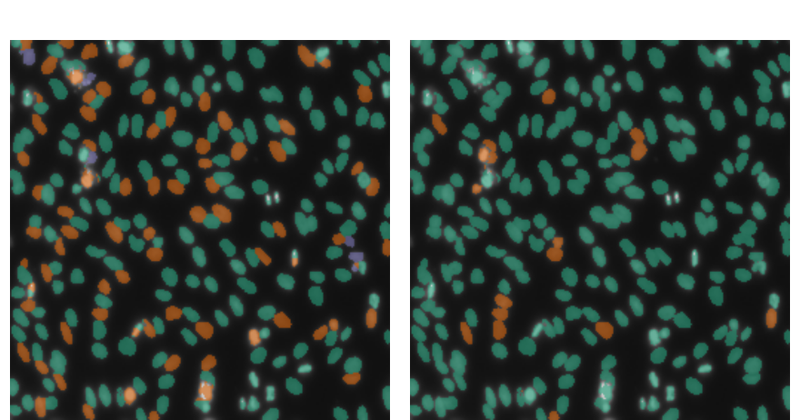
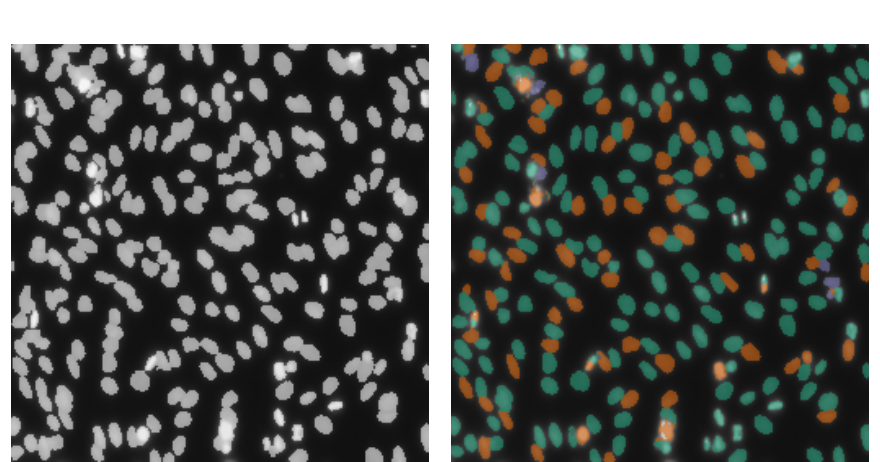
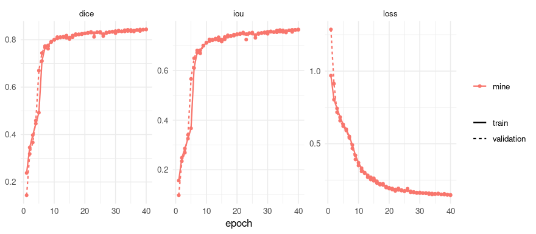
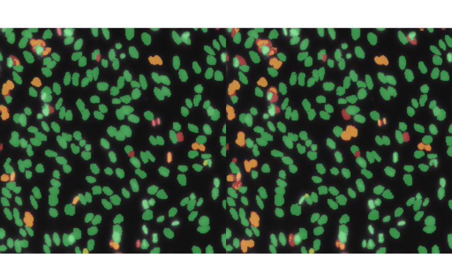
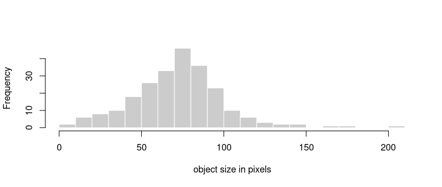

`vignette("data-science-bowl")` finds the nuclei in these pictures and stops there. Its
own closing warning is the reason this document exists: the mask it produces says
*nucleus* or *not nucleus* for every pixel, so two nuclei touching each other come back as
one region, and **a count taken from it would be wrong**.

This is the same dataset, read a different way. Nothing new was collected: the 2018 Data
Science Bowl ships one mask per nucleus, and the semantic vignette unites them. Here they
keep their identity, which turns the question from *where are the nuclei* into *how many
are there, and which pixels belong to which one*.

Every number and every picture below was produced by running the code shown.

## Before any of that: objects in four lines

Weights for this are published, so the difference is visible before anything is trained.
The borrowed model predicts three channels - background, the interior of a nucleus and a
rim around it - and `decode` says how those channels become objects:


``` r
borrowed <- platypus_spec(
  data = instance_data(validation_dir, validation_dir),
  models = list(u_net("objects", input_shape = c(256, 256), blocks = 4, filters = 16,
                      separation = separation_rim(width = 2),
                      decode = list(decode_nearest_seed(), decode_connected_components()),
                      weights = "dsbowl-instances", fit = FALSE))
)
loaded <- platypus_fit(borrowed, verbose = FALSE)
objects <- predict(loaded, split = "validation", decode = "nearest_seed")
length(objects)
#> [1] 134
```

An instance prediction comes back as a **list of integer label maps named by case**, not as
one array: objects numbered from 1, with 0 for background.

Now the same loaded file, decoded the other way. `connected_components` ignores the rim
channel entirely - it labels connected foreground, which is what a semantic mask gives you:


``` r
merged <- predict(loaded, split = "validation", decode = "connected_components")

counts <- data.frame(
  case = substr(names(objects), 1, 8),
  separated = vapply(objects, max, integer(1)),
  as_one_region = vapply(merged[names(objects)], max, integer(1))
)
head(counts[order(counts$as_one_region - counts$separated), ], 5)
#>                                                                      case
#> 547ef286ee5f4e5dce533e982e6992ada67b7d727fdd3cfa6576f24c631a7ae6 547ef286
#> 6fe2df6de1d962b90146c822bcefc84d0d3d6926fdfbacd3acdc9de830ee5622 6fe2df6d
#> 308084bdd358e0bd3dc7f2b409d6f34cc119bce30216f44667fc2be43ff31722 308084bd
#> 9bb6e39d5f4415bc7554842ee5d1280403a602f2ba56122b87f453a62d37c06e 9bb6e39d
#> 3ebd2ab34ba86e515feb79ffdeb7fc303a074a98ba39949b905dbde3ff4b7ec0 3ebd2ab3
#>                                                                  separated
#> 547ef286ee5f4e5dce533e982e6992ada67b7d727fdd3cfa6576f24c631a7ae6       245
#> 6fe2df6de1d962b90146c822bcefc84d0d3d6926fdfbacd3acdc9de830ee5622       214
#> 308084bdd358e0bd3dc7f2b409d6f34cc119bce30216f44667fc2be43ff31722        80
#> 9bb6e39d5f4415bc7554842ee5d1280403a602f2ba56122b87f453a62d37c06e       136
#> 3ebd2ab34ba86e515feb79ffdeb7fc303a074a98ba39949b905dbde3ff4b7ec0       137
#>                                                                  as_one_region
#> 547ef286ee5f4e5dce533e982e6992ada67b7d727fdd3cfa6576f24c631a7ae6           180
#> 6fe2df6de1d962b90146c822bcefc84d0d3d6926fdfbacd3acdc9de830ee5622           151
#> 308084bdd358e0bd3dc7f2b409d6f34cc119bce30216f44667fc2be43ff31722            56
#> 9bb6e39d5f4415bc7554842ee5d1280403a602f2ba56122b87f453a62d37c06e           114
#> 3ebd2ab34ba86e515feb79ffdeb7fc303a074a98ba39949b905dbde3ff4b7ec0           116
```


``` r
worst <- names(objects)[order(counts$as_one_region - counts$separated)][1]
shot <- read_images(
  list.files(file.path(validation_dir, worst, "images"), full.names = TRUE)[1],
  size = c(256, 256)
)
picture <- shot[1, , , ]

par(mfrow = c(1, 2), mar = c(0, 0, 2, 0))
plot(as.raster(overlay_instances(picture, objects[[worst]]) / 255), main = "nearest_seed")
plot(as.raster(overlay_instances(picture, merged[[worst]]) / 255),
     main = "connected_components")
```



One file of weights, one forward pass, two answers to *how many nuclei are in this
picture*. Neither colour map is decoration: adjacent objects are guaranteed different
colours, so a colour shared across a boundary is two nuclei the decoding ran together.

**No score is reported here, on purpose.** These weights were trained on `stage1_train`
and this directory is `stage1_validation`, which is the split they were measured on - the
numbers that mean something travel with them:


``` r
listing <- available_weights()
cat(strwrap(listing$description[listing$name == "dsbowl-instances"], 88), sep = "\n")
#> U-Net, 256x256, nuclei in light microscopy, trained to separate touching objects:
#> interior, rim and background. BBBC038v1 (the 2018 Data Science Bowl, CC0), the same 134
#> held-out images as `dsbowl-unet`. **One file, three scores** - instance average
#> precision 0.5445 by nearest_seed, 0.5390 by watershed and 0.4822 by
#> connected_components - so a number from these weights means nothing without the
#> decoding it came from. Foreground Dice 0.9118. The separation signal is worth +0.0623
#> here while a perfect mask is worth +0.2398: the mask is the limit on this data, not the
#> signal.
```

That description is the thing to read before quoting anything. **One file, three scores**:
the decoding is part of the number, and 0.0623 separates the best from the worst.

## The semantic sibling, side by side

`dsbowl-unet` is the published model from the other vignette: same data, same held-out
images, one foreground class. It is the comparison this whole document is about, so it is
worth seeing rather than describing:


``` r
semantic <- platypus_spec(
  data = segmentation_data(validation_dir, validation_dir, colormap = binary_colormap),
  models = list(u_net("mask", input_shape = c(256, 256), blocks = 4, filters = 16,
                      weights = "dsbowl-unet", fit = FALSE))
)
masks <- predict(platypus_fit(semantic, verbose = FALSE), split = "validation")
dim(masks)
#> [1] 134 256 256
```


``` r
where <- match(worst, list.dirs(validation_dir, recursive = FALSE, full.names = FALSE))

par(mfrow = c(1, 2), mar = c(0, 0, 2, 0))
plot(as.raster(overlay_mask(picture, masks[where, , ], binary_colormap) / 255),
     main = "dsbowl-unet: where the nuclei are")
plot(as.raster(overlay_instances(picture, objects[[worst]]) / 255),
     main = "dsbowl-instances: which is which")
```



The left-hand picture is not worse. It answers a different question, and if the answer you
need is *what fraction of this slide is nuclei* it is the one to use. The right-hand one is
what you need to count them, or to measure one of them.

## The data

The directory layout is the one the semantic vignette uses, because it is the same
directory:


``` r
stage1_train/
  00ae65c1c.../
    images/00ae65c1c....png
    masks/8a0ac8e3c....png      # one file per nucleus, 70 of them in this case
    masks/9a1e2f4b7....png
    ...
```


``` r
length(samples)
#> [1] 536
length(list.files(file.path(samples[1], "masks")))
#> [1] 27
```

`instance_data()` reads those per-object files as identities rather than uniting them,
which is the only difference from `segmentation_data()` at this level:


``` r
data <- instance_data(train_dir, validation_dir)
```

## The specification, with the borrowed model beside a new one

Two models in one specification: the published file, loaded and not trained, and the same
recipe trained here from scratch. `evaluate()` returns a row per model **and decoding**, so
one table holds the comparison the rest of this document rests on.


``` r
decodings <- list(decode_nearest_seed(), decode_watershed(), decode_connected_components())

spec <- platypus_spec(
  data = data,
  seed = 0,
  models = list(
    u_net("published", input_shape = c(256, 256), blocks = 4, filters = 16,
          separation = separation_rim(width = 2), decode = decodings,
          weights = "dsbowl-instances", fit = FALSE),
    u_net("mine", input_shape = c(256, 256), blocks = 4, filters = 16,
          separation = separation_rim(width = 2), decode = decodings,
          loss = loss_cce_dice(),
          metrics = list(metric_dice(), metric_iou()),
          optimizer = optimizer_adam(learning_rate = 0.001),
          augmentation = list(
            augmentation_step("HorizontalFlip", p = 0.5),
            augmentation_step("VerticalFlip", p = 0.5),
            augmentation_step("RandomRotate90", p = 0.5)
          ),
          epochs = 40, batch_size = 32)
  )
)
spec
#> platypus specification
#>   data        : /home/maju116/Desktop/PROJECTS/Personal Projects/PLATYPUS FAMILY/pyplatypus/examples/data/data_science_bowl/stage1_train 
#>   classes     : 0 
#>   models      : 2 
#>     published      u_net            256x256, cce, 10 epochs
#>     mine           u_net            256x256, cce_dice, 40 epochs
```

`separation` is one block per model and `decode` is a list, and the asymmetry is not
cosmetic: the separation sets what the network predicts, so changing it means another
training run, while a second decoding is another pass over the same predictions. Measured
on these 134 images, a second decoding costs **1.41 seconds**.

**Forty epochs rather than the published file's hundred and twenty**, deliberately: the
point of the table below is what a short run gets you against a converged one, and a reader
reproducing this does not need two hours to see the difference.

## Train


``` r
fit <- platypus_fit(spec, num_workers = 4)
fit
#> platypus fit
#>   models   : published, mine 
#>   device   : NVIDIA GeForce GTX 1070 (torch 2.7.1+cu126) 
#>   epochs   : mine=40 
#>   next     : evaluate(fit), predict(fit, "published")
```

`num_workers = 4` is worth copying. Measured on this model and this batch size, the same
epoch takes **17.5 seconds against 49.6** with the default of none: the GPU spends most of
a run waiting for PNGs to be decoded, and nothing about the model changes.


``` r
plot(fit)
```



## Compare


``` r
scores <- evaluate(fit)
scores[, c("model", "decode", "foreground_dice", "average_precision",
           "predicted_objects", "truth_objects")]
#>       model               decode foreground_dice average_precision
#> 1 published         nearest_seed       0.9117900         0.5444811
#> 2 published            watershed       0.9117900         0.5390481
#> 3 published connected_components       0.9117900         0.4821945
#> 4      mine         nearest_seed       0.9015549         0.5011777
#> 5      mine            watershed       0.9015549         0.5003432
#> 6      mine connected_components       0.9015549         0.4655490
#>   predicted_objects truth_objects
#> 1              5378          5999
#> 2              5378          5999
#> 3              4914          5999
#> 4              5127          5999
#> 5              5127          5999
#> 6              5015          5999
```

Three things in that table, in the order they matter.

**Within either model, the mask is identical across its three rows.** There is one forward
pass; the rows differ only in how its channels were turned into objects. So the spread
between a model's own rows is the decoding's contribution and nothing else.

**`connected_components` is the row the others are read against.** It throws the rim channel
away, so it is what the separation signal is worth being compared to - not a weaker model,
the same model asked a question that ignores half its output.


**The forty-epoch run is 0.0102 behind on the mask and
0.0433 behind on average precision** - the two numbers written by
the run above rather than by hand, so re-knitting this document cannot leave them stale.

Two runs of one configuration on this data differ by about **0.009** of average precision -
measured, and the recorded spread every claim here is read against. The mask gap above is one
of those, so on foreground Dice the short run is barely distinguishable from the published one,
while the score gap is 4.8 of them. **The extra eighty
epochs bought a sharper rim rather than a better mask**, and `foreground_dice` cannot see a sharper rim: the rim is a third class whose quality
only becomes visible once the channels are decoded into objects, which is the same reason the
`class dice` column exists beside it.

That is a finding about time inside one recipe, and the next section is a finding about
recipes. They do not contradict each other, and reading one as the other is the mistake this
document is arranged to prevent.

## What this does not settle, measured rather than guessed

The instance milestone closed on numbers that say the interesting part is somewhere else:

| route | instance AP on these 134 images |
|---|---|
| the published semantic weights through connected components | 0.4888 |
| **a perfect semantic mask** through connected components | **0.7655** |
| the published separation weights, `nearest_seed` | 0.5445 |
| a perfect mask through the same separation route | 0.9846 |

So connected components caps *any* model here at 0.7655 - a flawless mask still scores
that - and the separation signal is worth about +0.06 on top of the mask it is computed
from, where fixing the mask is worth +0.24. Three trained signals were compared and they
agree; a bigger network was measured and moved the score by less than the run-to-run
spread.

Read that as a closed direction rather than as a run to tune: on this data the headroom is
in the mask, and a document that ended on a score would be claiming the opposite of what
was measured.

## Which objects, not how many pixels

A score cannot tell you whether you found the wrong nuclei or drew the right ones badly.
`overlay_instance_agreement()` matches predicted objects to true ones the way the metric
does and colours the three outcomes, so the failure is visible by kind.

The truth has to be assembled from the per-object files, which is four lines and worth
seeing - `read_images(nearest = TRUE)` matters, because interpolating a label map invents
numbers belonging to no object:


``` r
truth_map <- function(case, size = c(256, 256)) {
  files <- list.files(file.path(case, "masks"), full.names = TRUE)
  stack <- read_images(files, size = size, channels = 1, nearest = TRUE)
  labels <- array(0L, dim = size)
  for (i in seq_along(files)) labels[stack[i, , , 1] > 0.5] <- i
  labels
}

actual <- truth_map(file.path(validation_dir, worst))
c(objects_in_the_files = length(list.files(file.path(validation_dir, worst, "masks"))),
  objects_that_survived_the_resize = length(setdiff(unique(as.vector(actual)), 0L)))
#>             objects_in_the_files objects_that_survived_the_resize 
#>                              257                              257
```


``` r
mine <- predict(fit, "mine", split = "validation", decode = "nearest_seed")

par(mfrow = c(1, 2), mar = c(0, 0, 2, 0))
plot(as.raster(overlay_instance_agreement(picture, objects[[worst]], actual) / 255),
     main = "published")
plot(as.raster(overlay_instance_agreement(picture, mine[[worst]], actual) / 255),
     main = "mine, 40 epochs")
```



Green is a true object matched by a prediction, red one that nothing matched, yellow a
prediction matching nothing. The threshold is an IoU of 0.5 and it cannot be lowered below
that: under 0.5 one prediction can satisfy two true objects at once, the match stops being
one to one, and the average precision refuses the same thing for the same reason.

## A decoding changed without retraining

This is what `decode` being a list is for. No model is loaded again and nothing is trained:


``` r
again <- lapply(c("nearest_seed", "watershed", "connected_components"), function(how) {
  maps <- predict(fit, "mine", split = "validation", decode = how)
  data.frame(decode = how, objects = sum(vapply(maps, max, integer(1))))
})
do.call(rbind, again)
#>                 decode objects
#> 1         nearest_seed    5127
#> 2            watershed    5127
#> 3 connected_components    5015
```

Against 5,999 objects in the truth. The counts, not the scores, are where the decoding
shows itself most plainly: the gap between the first row and the last is nuclei that were
found and then run together with a neighbour.

## What it was for: a count and a size distribution

`instance_sizes()` is the end of this road. One label map in, one row per object out:


``` r
sizes <- instance_sizes(mine[[worst]])
head(sizes, 3)
#>   object voxels
#> 1      1     20
#> 2      2     18
#> 3      3     46
summary(sizes$voxels)
#>    Min. 1st Qu.  Median    Mean 3rd Qu.    Max. 
#>    5.00   56.50   74.00   73.16   87.75  207.00
```


``` r
hist(sizes$voxels, breaks = 20, col = "grey80", border = "white",
     main = "", xlab = "object size in pixels")
```




``` r
per_case <- vapply(mine, max, integer(1))
c(images = length(per_case), objects = sum(per_case),
  median_per_image = median(per_case), most_in_one_image = max(per_case))
#>            images           objects  median_per_image most_in_one_image 
#>               134              5127                26               234
```

**In pixels, because this dataset has no physical scale.** `instance_sizes()` takes a
`spacing` in millimetres and returns an area or a volume when you give it one - that is what
a CT scan carries in its header, and `vignette("volumes")` ends in millilitres for exactly
that reason. These are microscopy images with no calibration recorded, so a number in
micrometres here would be invented. A count is still a count.

## The same thing from a file


``` r
spec <- platypus_spec("experiment.yaml")
fit  <- platypus_fit(spec, num_workers = 4)
```

The configuration guide's *Instances instead of one mask* section has the YAML for this,
field by field.

## A note on older graphics cards

PyTorch 2.8 and later ship CUDA 13 builds, and CUDA 13 dropped the Maxwell, Pascal and
Volta generations - a GTX 10-series card cannot run them, and no driver update changes
that. Without saying anything, everything above would run on the processor instead,
perhaps ten times slower.

If `platypus_device()` reports `cpu` on a machine that has a GPU, restart R and ask for the
older build before anything else:


``` r
library(rplatypus)
platypus_use_torch("pascal")
```


``` r
platypus_device()
#> torch      : 2.7.1+cu126 
#> cuda build : 12.6 
#> device     : NVIDIA GeForce GTX 1070
```
